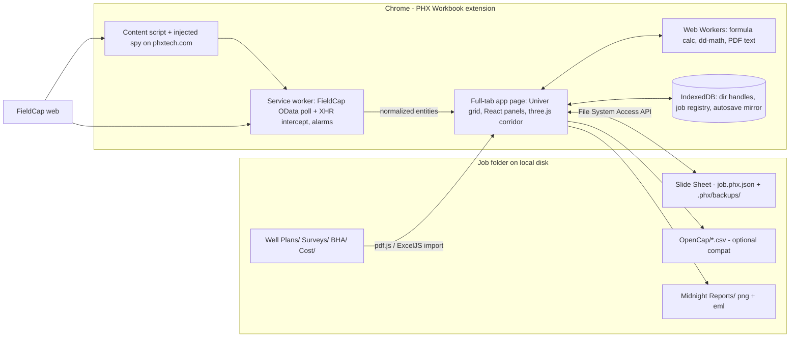

# Browser Workbook Port (Slide Sheet → Chrome extension) — 2026-11-03

## Goal

Replace the Excel `Slide Sheet - <job>.xlsm` with a Chrome extension that is the workbook: a full grid-and-formula clone of every sheet, the VBA re-implemented in TypeScript, live FieldCap data written straight into the cache sheets (no CSV hop), and the job folder on the local machine kept as the single store. One copy per job, no distributed spreadsheets, no server.

Example job folder (kept as-is): `D:\TEL HZ CARROT\TEL HZ CARROT 12-21-52-11 (35782)\` with `BHA/`, `Cost/`, `Fit Document/`, `Midnight Reports/`, `OpenCap/`, `Safety/`, `Surveys/`, `Town/`, `Well Plans/`.

## Approved choices

| Decision | Choice |
|----------|--------|
| Source of truth | Target state: one native job file inside the job folder, local machine. Folder sync (OneDrive/USB) if shared. No server. During migration, Excel remains authoritative until Phase 7 cutover. |
| Port style | Full workbook clone: every sheet (visible, hidden, `_OC_*` very-hidden) as a grid sheet; Excel formulas kept; VBA UDFs become custom formula functions. |
| Store format | Native Univer `IWorkbookData` JSON snapshot. xlsx is import (one-time migration) and export (office) only. |
| Email | Build a ready-to-send `.eml` (HTML body, CID `daily_report.png`, pinned attachments) into `Midnight Reports/`; open a temporary Chrome-download copy in the default mail client. No Outlook COM, no Graph. |
| FieldCap | Read-only live sync (OData poll + XHR intercept). Manipulation stays in the workbook. |
| Licensing | Apache-2.0 / MIT only: Univer OSS core, ExcelJS, three.js, pdf.js. No Univer Pro, no HyperFormula/Handsontable. |
| Port method | Parity-driven strangler. Phases 0–6 are previews beside the authoritative `.xlsm`. Phase 7 verifies all operational paths, re-imports the latest `.xlsm`, makes `.phx.json` the sole editable source, and retains the `.xlsm` as a locked fallback. |

## Current behavior (baseline)

- `src/chrome-extension/` (MV3 v3.2.15, plain JS): FieldCap OData + XHR interception + DOM scrape → six CSVs under `<folder>/OpenCap/`, folder via `showDirectoryPicker` handle in IndexedDB, `chrome.downloads` fallback.
- `Slide Sheet - Demo.xlsm` / `Slide Sheet - 35783.xlsm`: ~30,000 lines of VBA in ~30 components (see `bas/cache_demo/MANIFEST.txt`), 25 sheets and 20,288 formula XML nodes (12,611 shared; 16 array). Visible sheets are `Setup`, `Data`, `Slidesheet`, `Cont DI`, and `DL Tracker`; five sheets are hidden and fifteen are very-hidden caches.
- Excel-only dependencies: Outlook COM (`Module11`), `Shapes` + `Chart.Export` (`MDL_CorridorImage`, `MDL_PlanGauge`), UserForms (5), ribbon customUI, Poppler `pdftotext` (`MDL_PlanImport`, AC import), sheet protection.

## Architecture

### 1. Extension shell

- MV3. Vite + `@crxjs/vite-plugin` + TypeScript + React. Source under `src/extension/`; the current `src/chrome-extension/` keeps shipping unchanged until Phase 6.
- Toolbar click opens one full-tab app page (`app.html`). The popup is retired. Side panel is optional later (`sidePanel` permission reserved).
- Service worker: FieldCap sniff/poll logic from `background.js` ported to TS modules; `chrome.alarms` for cadence; runtime messaging to the app page.
- Content script + `injected-spy.js`: unchanged behaviour, TypeScript.
- Permissions: `storage`, `unlimitedStorage`, `alarms`, `scripting`, `activeTab`, `webRequest`, `downloads` (fallback only); Phase 5 adds `downloads.open`; host access narrows to exact production origins before Phase 6.
- Security baseline: explicit restrictive MV3 CSP; no remote code or unsafe evaluation; imported rich text is rendered as text; hyperlinks are inert until an `https:` destination passes validation. Package versions are exact and locked; CI uses frozen installs, blocks unapproved lifecycle scripts, audits provenance/vulnerabilities, and emits an SBOM.

### 2. Workbook engine

- Univer OSS: `@univerjs/core`, `design`, `engine-render`, `engine-formula`, `ui`, `sheets`, `sheets-ui`, `sheets-formula`, `sheets-formula-ui`, `sheets-numfmt`, `sheets-data-validation`, `sheets-conditional-formatting`, `sheets-drawing`, `sheets-drawing-ui`, `sheets-hyper-link`, `sheets-thread-comment`, permission plugins.
- Formula engine in a Web Worker (Univer RPC pattern). Custom functions are registered inside that worker.
- Sheet visibility: visible → visible; hidden and veryHidden → hidden (Univer has one hidden state; a `veryHidden` flag in the side-car keeps them out of the sheet tab context menu).
- Protection: Univer range/worksheet permission replaces `MDL_SheetProtect`.
- Custom functions: every VBA UDF referenced by a cell formula is registered via `sheets-formula` (`ProjBurr`, `ProjMetersToSlide`, `ProjReqTF`, `MinCurveStep`, `DoglegBelow`, `PG_*`, TD helpers, and any others found by scanning formulas during import). Implementations come from `dd-math`.
- Anything in a formula Univer cannot evaluate is reported by the parity harness and either implemented as a custom function or rewritten in the import mapper.

### 3. Storage and job folder

- Job registry (IndexedDB): `{ jobId, label, dirHandle, lastOpened }`. Pick a folder once; Chrome 122+ "Allow on every visit" persists the grant. The root handle is private to the storage/import service and is never passed to Univer plugins or general UI components.
- Store file: `<job folder>/Slide Sheet - <job>.phx.json` uses a durable application envelope: `{ schemaVersion, univerAppVersion, sourceWorkbookHash, savedAt, workbook: IWorkbookData, sidecar }`. Sidecar holds what the sheet model cannot: `veryHidden` flags, 3D camera, panel layout, DL Tracker metadata, FieldCap sync cursor, email headers (To/CC/Subject) if not yet moved to cells. Schema migrations preserve unknown plugin resources.
- Autosave: 2 s debounce → IndexedDB mirror; 30 s or window blur → canonical folder file. Take a validated backup first, write with `createWritable({ mode: "exclusive" })`, close, then reopen and verify schema, parse, hash, and semantic round-trip. The API commits through its own swap file; no application `.tmp` rename path.
- Retention: recent restore points plus daily and weekly snapshots. Backups are not created on every 30-second save. A job removal action deletes its IndexedDB mirror and stored handle; stale temporary artifacts are purged.
- Recovery is a state machine: permission blocked/reconnect, invalid or future schema, corrupt snapshot, newer IDB mirror, save failure, and concurrent writer. A corrupt canonical file is never overwritten before the user restores a validated backup or mirror.
- Job switching and imports await a folder save. Because tab teardown cannot reliably complete asynchronous filesystem writes, a dirty or folder-unsafe workbook raises `beforeunload` instead of claiming a last-second save.
- Folder browser panel: lists `BHA/`, `Well Plans/`, `Surveys/`, `Cost/`, `Midnight Reports/`, `OpenCap/` so import pickers start in the right subfolder.

### 4. Excel bridge

- Import (`packages/xlsx-bridge`): ExcelJS reads ordinary workbook objects, while a direct OOXML overlay reads `xl/workbook.xml`, worksheet XML, relationships, and styles where ExcelJS is lossy. Shared formulas are expanded to explicit cell formulas; array masters retain their ranges; all 1,001 defined-name nodes preserve formula/constant text, `localSheetId`, hidden state, and built-in metadata; cell locked/hidden flags and worksheet protection map to Univer permissions. Values, formats, merges, dimensions, validation, conditional formatting, and comments then map into `IWorkbookData`. Macros, Shapes, Charts, and Form controls are not carried (replaced by the TS port). The import log lists what was dropped.
- Treat every imported workbook as untrusted input: reject oversized ZIP expansion, excessive dimensions/formulas/dependency depth, external references, active/local-file links, and calculations that exceed a time budget before replacing the active workbook.
- Export: reverse mapper → `.xlsx` for the office, on demand, into the job folder or a chosen path. Also used by the parity harness.
- Migration of `Slide Sheet - 35783.xlsm`: open → import → save native. The `.xlsm` is never written.

### 5. VBA port map

Each module gets golden-test fixtures extracted once from the Demo workbook (Excel COM via PowerShell under `bas/`, fixtures stored under `src/packages/dd-math/fixtures/`).

- `packages/dd-math` (pure TS, worker-safe): `MDL_ProjBit` (minimum curvature, `DoglegBelow`, ISCWSA §8.2 constant-toolface walk, calibrated AZM walk, BURR, AS, spherical AT), `MDL_PlanGauge` math (closest point on plan, Well Seeker high-side/right frame, TVD mode under sail corridor), `MDL_TDCalc`, `MDL_WellborePos`, `MDL_ContDI`, `MDL_DayRoll` depth clipping, `Module19` stands.
- Sheet commands (Univer Facade, `packages/workbook-commands`): `MDL_SlidesheetClear` (clear ranges, `RefreshSlideComments`, active target highlight), `MDL_Setup` (Refresh, seeding, `RebuildSetup`, `RedrawCrewAndAc`), `MDL_PipeTally`, `MDL_CostsForm`, `MDL_DownlinkTracker`, `MDL_ToolHours`, `MDL_PdmConf`, `Module23` DD Tools, `Module9` NEW_SS, `Module12`, `Module13`, `Module14`, `Module17`.
- Forms → React dialogs: `frmPipeTally`, `frmCosts`, `frmDayHours`, `frmDLEntry`, `frmTargets`.
- Imports (`packages/importers`): `MDL_PlanImport` and AC import via pdf.js text-with-positions (replaces Poppler); COMPASS plan CSV; Well Seeker survey report `.txt`; survey `.xlsx` from `Surveys/`.
- Retired: `MDL_ScreenGuard`, `MDL_Ribbon`, `MDL_SheetProtect` (engine-native), empty `Module4/6/7/8/15/22`.

### 6. Rendering

- `packages/corridor-3d`: three.js scene, WebGPU renderer with WebGL2 fallback. Implements `.cursor/rules/corridor-picture.mdc` exactly: C4→C5 window, I4/J4 never frames the camera, 40 m survey tolerance, shaft (< 5°), build (5° to < 80°) with 16 pt bullseye on in-window named targets, MD tunnel (≥ 80°) with geo band and AA14 L/R, 1:1 shaft axes, 0.18/0.88 tunnel tilt. Interactive in a panel; `toDataURL` yields `daily_report.png` at the same pixel size as today. `RenderCorridorExample(mdFrom, mdTo)` segment pictures supported.
- Proximity dial: SVG, inserted as a floating drawing over `AA1:AC7`, recomputed on survey change.
- Position of Wellbore numbers from `dd-math`.

### 7. Reports and email

- `Module21` morning report and mini summary → text builders → clipboard and optional `.txt` into `Midnight Reports/`.
- `Module11` EMAIL → audited MIME builder (`multipart/mixed` + `multipart/related`): HTML body, CID PNG, visible `daily_report.png`, attachments from `Data!I29:I33`. Reject control characters in headers, normalize recipients, HTML-escape workbook values, prohibit remote/active content, constrain attachments to approved job-folder paths, and show an immutable recipient/attachment review. Write the archival copy to `Midnight Reports/<yyyy-mm-dd> Daily Report.eml`; on the Send button, create a temporary Chrome download copy and call `chrome.downloads.open()` under that user gesture so the default mail client opens it.
- PDF: Data sheet printed through the browser print pipeline with a print stylesheet; saved to `Midnight Reports/`.

### 8. FieldCap live sync

- Service worker polls OData (`ClientJobs`, `ClientJobCustomValues`, `JobSchedules`, `ToolAssemblies`, `ToolAssemblyItems`, `JobTools`, `ActivityLogs`, `SurveySheetEntries`, Ticket sets) on a configurable alarm (default 60 s) while a FieldCap tab is open; intercepted XHR fills hours/metres as today. Edge keeps the in-tab fetch path.
- The six CSV builders become typed normalizers (`packages/fieldcap-sync`). The app writes rows into `_OC_Job`, `_OC_Crew`, `_OC_BHA`, `_OC_Slide`, `_OC_Inventory`, `_OC_Costs` through the Facade and flags changed cells; the same seeding logic as `MDL_Setup` Refresh runs afterwards.
- Compatibility toggle still writes `OpenCap/*.csv` during the transition.
- Read-only: no POST/PATCH to FieldCap.
- Limit host access to exact production origins. Authenticate page-to-content messages with a per-tab nonce and source checks; validate sender URL, endpoint, entity type, schema, and payload size in the service worker. Cookies and authorization headers are never logged or persisted.

### 9. Testing

- Step 0 compatibility gate: before building the extension shell or production storage, map formulas, names, protection, and representative styles from Demo into headless Univer; round-trip the snapshot and meet the non-UDF parity threshold.
- Expected-value oracle: run `CalculateFullRebuild` on a copy of Demo in desktop Excel, wait for calculation completion, and seal an immutable manifest with workbook hash, Excel version, calculation settings, and timestamp.
- Parity harness (Node): direct OOXML + ExcelJS → mapper → headless Univer → force calculation → await `onCalculationResultApplied()` → compare against the sealed manifest (numeric abs 1e-6 and rel 1e-9, text exact). The denominator is evaluable non-UDF-dependent formulas; report direct and transitive UDF coverage, require zero unclassified formulas, enumerate every UDF-dependent cell, and fail when mapper/engine mismatches are `>= 0.5%`.
- `dd-math` golden tests from Demo fixtures.
- Playwright e2e: deterministic adapter/OPFS tests in CI plus a required headed-Chrome release smoke test using a real temporary Windows directory (grant restoration, browser restart, exclusive write, lock failure, recovery, and retention).
- Local-only compatibility run: import `Slide Sheet - 35783.xlsm` read-only, verify representative non-UDF recalculation and snapshot round-trip, then discard the native output. No Field artifact or report enters git.
- All fixtures and scripts under `src/`, `bas/`, or `docs/`; nothing new in the repo root.

### 10. Phases

Each phase gets its own plan.

0. Headless compatibility spike and sealed Excel oracle → go/no-go for Univer + the OOXML mapper.
1. Shell + safe storage + Excel import + parity harness → migration/engine preview; `.xlsm` remains authoritative.
2. `dd-math` + custom functions + Slidesheet commands + math parity → slide advisor works in preview.
3. Corridor 3D + gauge + daily PNG.
4. Forms, day roll, costs, DL tracker, pipe tally, tool hours, DD Tools.
5. Reports, `.eml` email, xlsx export, PDF.
6. FieldCap live sync replaces CSVs; retire `src/chrome-extension/`.
7. Verify all operational paths, re-import the latest `35783`, field pilot with the `.xlsm` locked as fallback, then make `.phx.json` authoritative and retire Excel editing.

## Constraints carried over

- `Slide Sheet - 35783.xlsm` and real job exports never enter git.
- Repo root stays clean; new code under `src/extension/` and `src/packages/`.
- Corridor rules in `corridor-picture.mdc` are the acceptance test for Phase 3.
- Demo first, Field second applies to fixtures: Field data is only used locally for the pilot.
- During Phases 0–6, native snapshots are disposable evaluation state and the `.xlsm` is the only editable authority. At Phase 7 cutover, re-import the latest `.xlsm`, make the native file the only editable authority, and mark the `.xlsm` read-only as fallback.

## Out of scope

- Multi-user editing, server sync, FieldCap write-back, Univer Pro features, mobile.
